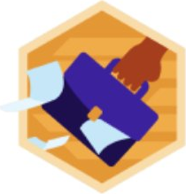
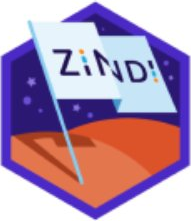

<!-- Profile README for github.com/amkkoussay — Colorful & interactive edition -->

  

  

  

    
    
    
    
  

  

    
    
    
    
  

---

##  Hi, I'm Koussay

I'm a Tunisian high-school student (Sciences de l'Informatique, bac 2028) building applied-AI and health tools that know their limits. I work on applied AI, health informatics, agriculture, and climate risk — small systems with clear limits and readable behavior.

> 🔬 **Honesty engineering** — *the boy who teaches machines to say: I don't know.* My research and my projects ask the same question: what does a system owe the people who trust it, when its data cannot be trusted?

 

---

## 🛠️ My toolbox

  

<i>Python · JavaScript · Flask · React · Vite · SQLite · Git — small stack, shipped often.</i>

---

## 🚀 Featured projects

  
  

- 🌧️ **[Rain2Risk](https://github.com/amkkoussay/rain2risk)** — transparent relative flood-risk screening with documented data limits and tests. **Live:** [rain2risk.vercel.app](https://rain2risk.vercel.app)
- 🌾 **[CropGuide AI](https://github.com/amkkoussay/cropguide-ai)** — agricultural decision support with explicit uncertainty, data audits, and tests.

> *Honest limits, printed on the label: both are exploratory software. CropGuide AI is not a substitute for agricultural expertise; Rain2Risk is a screening score, not an official warning or forecast.*

<b>📂 More builds — click to open</b>

 

| Project | What it is |
|---|---|
| [Bakery ERP Pro](https://github.com/amkkoussay/bakery-erp-pro) | Bakery management demo — stock, sales, production (a demo project, not production ERP) |
| [AI Health Assistant](https://github.com/amkkoussay/ai-health-assistant) | Health-assistant prototype built on careful, limited claims |
| [Clinique](https://github.com/amkkoussay/clinique) | Clinic management system |
| [Finance Platform](https://github.com/amkkoussay/finance-platform) | Personal-finance tracking platform |

---

## 📄 Research spotlight

**[AI-Based Clinical Decision-Support System Robustness Under Unreliable Patient Data](https://doi.org/10.5281/zenodo.22883408)** — a narrative review and thematic synthesis, published as a preprint on Zenodo in 2026. Fifteen studies, six robustness themes, one conclusion: a clinical AI that cannot say *"I don't know"* is not safe yet.

  

---

## 🏆 Competitions

**[Bias Bounty: Mapping Equity Challenge](https://zindi.world/competitions/bias-bounty-mapping-equity-challenge)** on Zindi (Humane Intelligence × Radiant Earth) — estimating Overture Maps coverage gaps across 9,794 US census tracts with a fully documented, reproducible, no-training methodology. The challenge closes 31 Oct 2026; the final ranking rests on a private leaderboard.

- 📉 Public RMSE **0.1966 → 0.1042** across five logged submissions — the honest route: a rule-based index, a wrong denominator found and fixed, then shrinkage toward regional means.
- 🏅 Zindi badges earned so far — and ranked **#9,686 among 100,000+ AI builders** on the platform:

  
  
  

First Steps · Go-Getter · Zindian

- 📝 The complete methodology write-up (including the failed first version, and why) goes public with the project repo once the challenge closes.

  
  
  

---

## 📊 The numbers, live

  
  

  

  

---

## 🎓 Certificates I'm proud of

<b>🏅 Verified highlights — click to open</b>

 

- **CS50AI — Introduction to AI with Python** · Harvard / CS50 — [verify](https://cs50.harvard.edu/certificates/6705d1c7-ac82-4ff6-9acb-69c41451c193)
- **Elements of AI** · University of Helsinki / MinnaLearn (2 ECTS) — [verify](https://certificates.mooc.fi/validate/4xcr09f8z9d)

### Certificates

- **AI in Healthcare Specialization** · Stanford Online (Coursera)
- **AI in Government** · Oxford Saïd

---

  

  

  
  Thanks for stopping by — the next build is already on the desk. · © 2026 Koussay Mehdouani

